# Combining FashionCLIP and Local Language Models for Outfit Recommendation

This is a CS664 term project that creates a personal wardrobe from uploaded clothing photos. It uses Marqo-FashionCLIP to categorize garments and a local Ollama model to suggest outfits using the selected wardrobe. Users can edit their own clothing details and refine outfit suggestions through a React/TypeScript interface with a Python backend. Photos and conversations stay on the computer, and the app works offline after setup. Evaluation uses 16,411 locally supplied [DeepFashion2](https://github.com/switchablenorms/DeepFashion2) validation photos, approximately 50% of its published 33,669-image validation set; this collection is separate from the personal wardrobe.

## Demo

https://github.com/user-attachments/assets/b8074420-3931-4c73-802d-67622715ddb8

## Workflow



## Setup

Install Python 3.11, Node.js 22, and [Ollama](https://ollama.com). Start Ollama, then run these commands from the project folder:

```sh
python3.11 -m venv .venv
.venv/bin/python -m pip install -r backend/requirements.txt
cd frontend
npm ci
npm run build
cd ..
```

## Models

The clothing model is [Marqo-FashionCLIP](https://huggingface.co/Marqo/marqo-fashionCLIP); DeepFashion2 is the optional image dataset used for evaluation. Model weights are downloaded separately and are not included in this repository.

After installing the dependencies, run these commands from the project folder with an internet connection:

```sh
.venv/bin/python scripts/download_models.py
ollama pull gemma3:4b
```

The script downloads the pinned FashionCLIP configuration and weights into `models/fashionclip/`. Ollama stores Gemma 3 4B in its own local model library. Once both downloads finish, normal use works offline with Ollama running.

## DeepFashion2 wardrobe

Download the dataset separately to use the DeepFashion2 wardrobe and benchmarks. Personal uploads work without it.

1. Open the authors' [download instructions](https://github.com/switchablenorms/DeepFashion2#download-the-data) and complete their [access form](https://docs.google.com/forms/d/e/1FAIpQLSeIoGaFfCQILrtIZPykkr8q_h9qQ5BoTYbjvf95aXbid0v2Bw/viewform?usp=sf_link) to obtain the archive password.
2. Download the validation archive from the official [Google Drive folder](https://drive.google.com/drive/folders/125F48fsMBz2EF0Cpqk6aaHet5VH399Ok?usp=sharing) and extract it using that password.
3. Create `data/deepfashion2/` in this project and copy the JPEGs from the extracted `validation/image/` folder directly into it. Keep the original filenames, such as `data/deepfashion2/000001.jpg`. Do not nest the `validation` or `image` folders inside `data/deepfashion2`; annotation JSON files are not needed.
4. After completing Setup, run this from the project folder to categorize the photos and save their embeddings:

```sh
.venv/bin/python scripts/index_deepfashion2.py
```

Start the app as described below, or refresh it if already running, then select DeepFashion2. A smaller subset also works, but benchmark results depend on the images indexed.

## Run

Keep Ollama running, then run this from the project folder:

```sh
./scripts/run.sh
```

Open http://127.0.0.1:8000. Press Ctrl+C to stop the app.

Switch to DeepFashion2 and select Run benchmark to evaluate ten fixed outfit requests in the stylist panel. The dataset has no footwear category, so its outfits can be marked as partial. The image source and validation-set size are documented by [Ge et al., DeepFashion2 (2019)](https://arxiv.org/abs/1901.07973) and the [dataset repository](https://github.com/switchablenorms/DeepFashion2).
